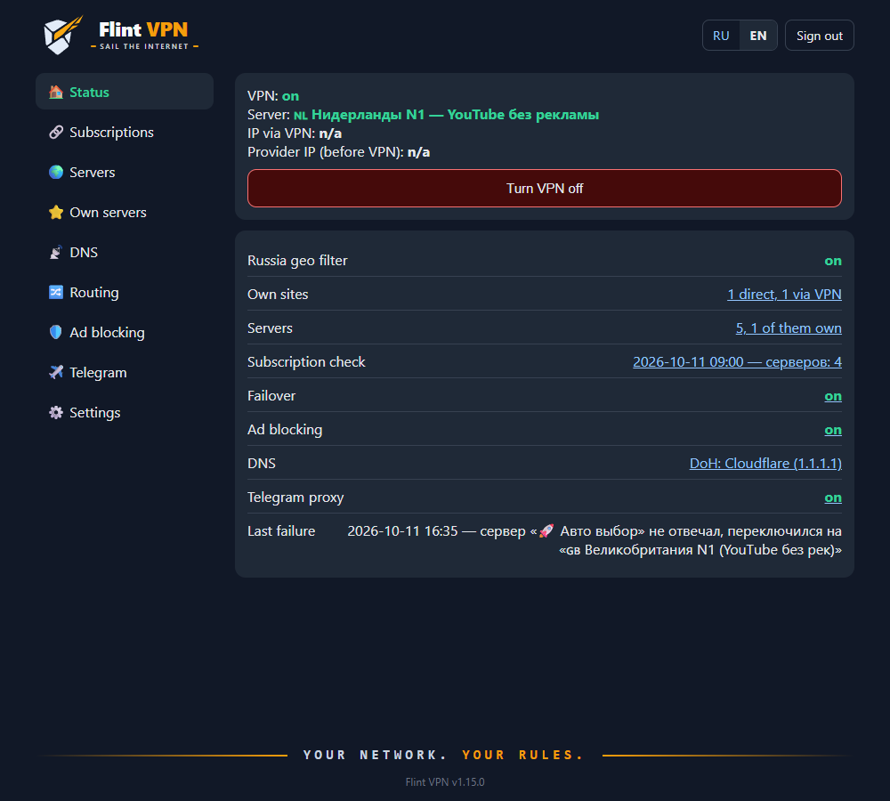
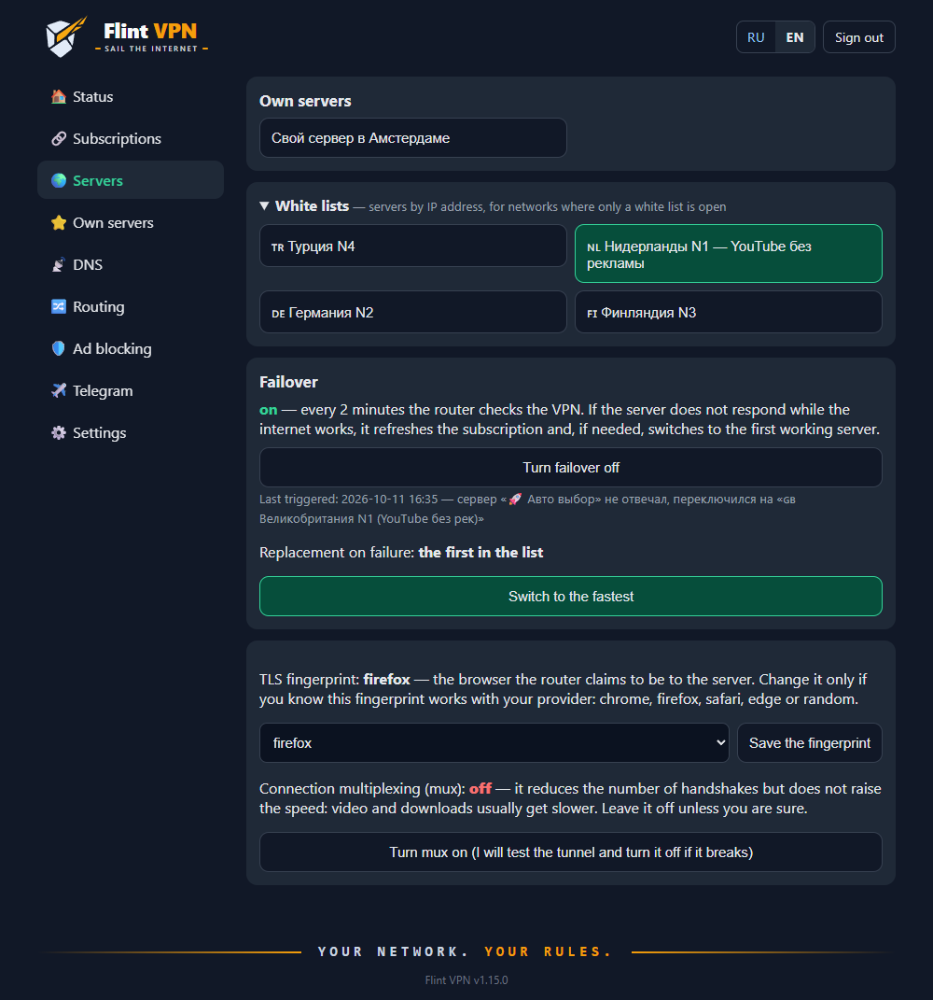
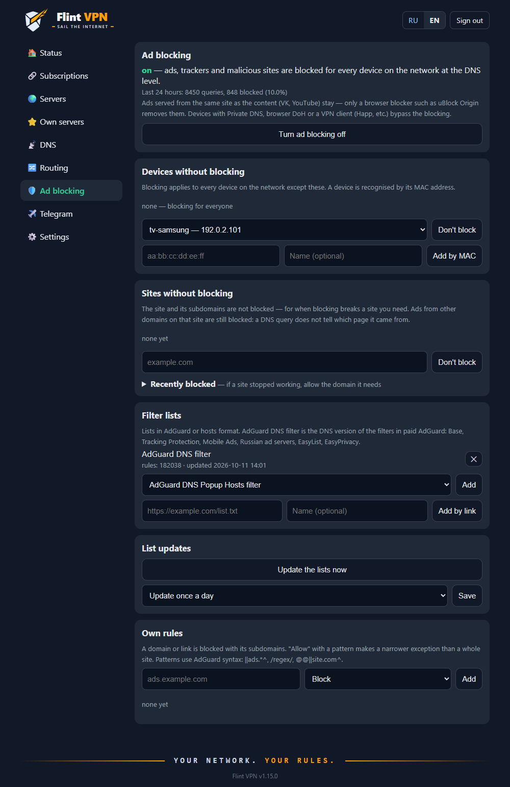
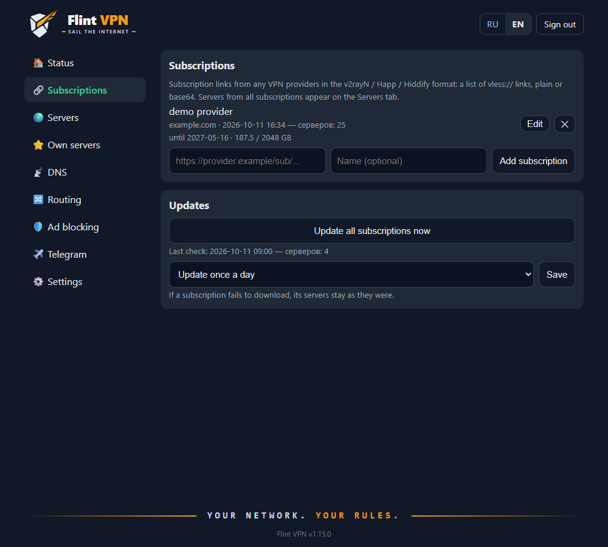
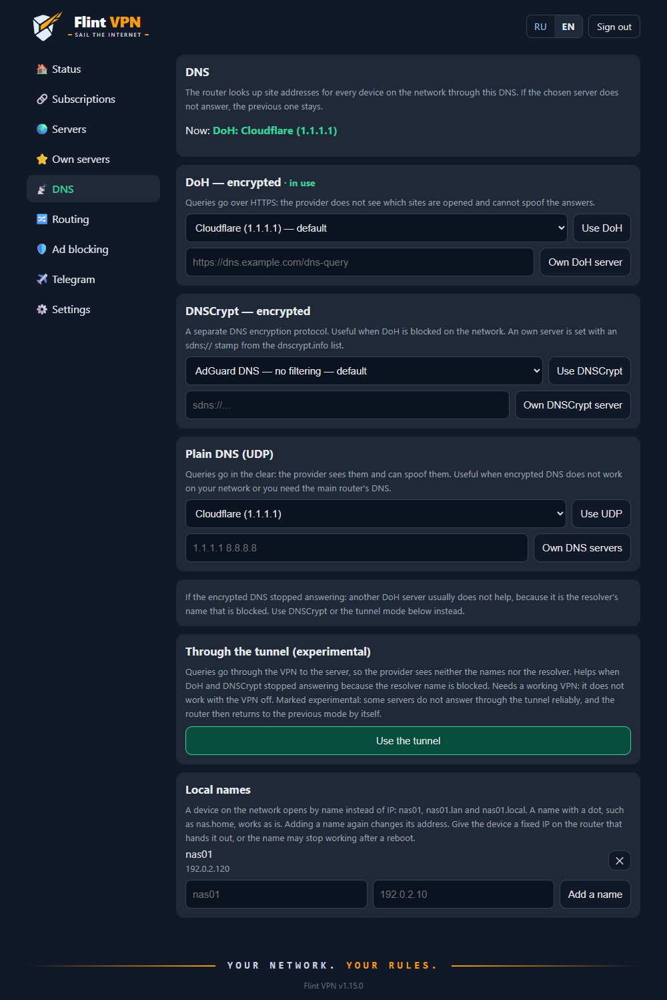
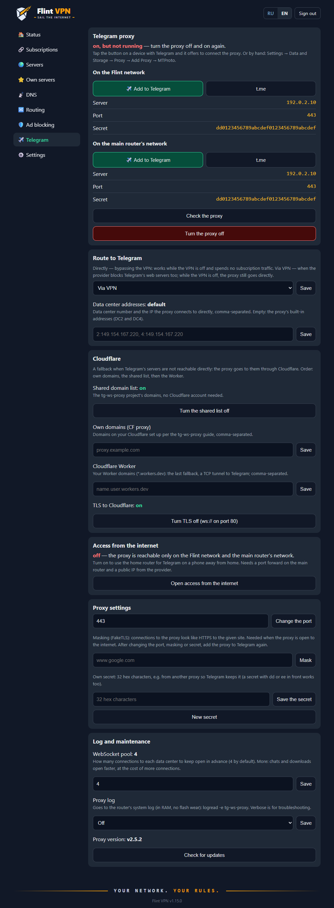
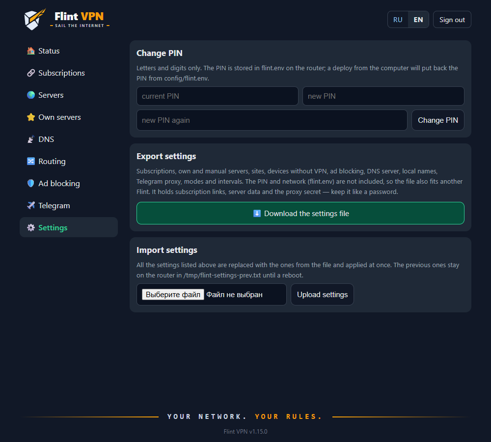
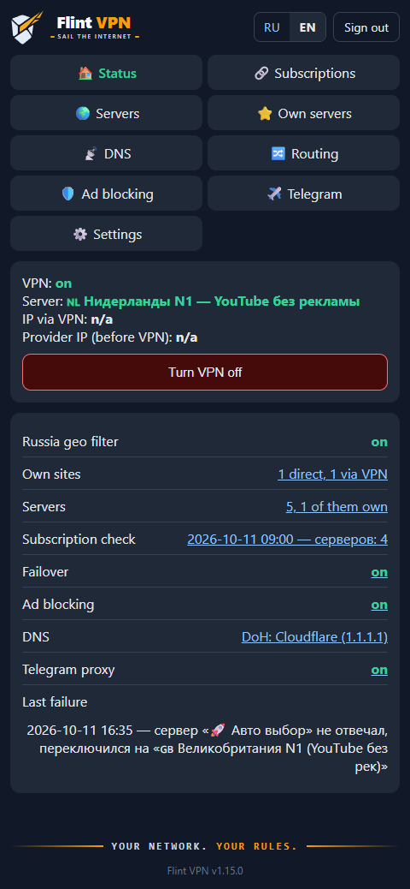
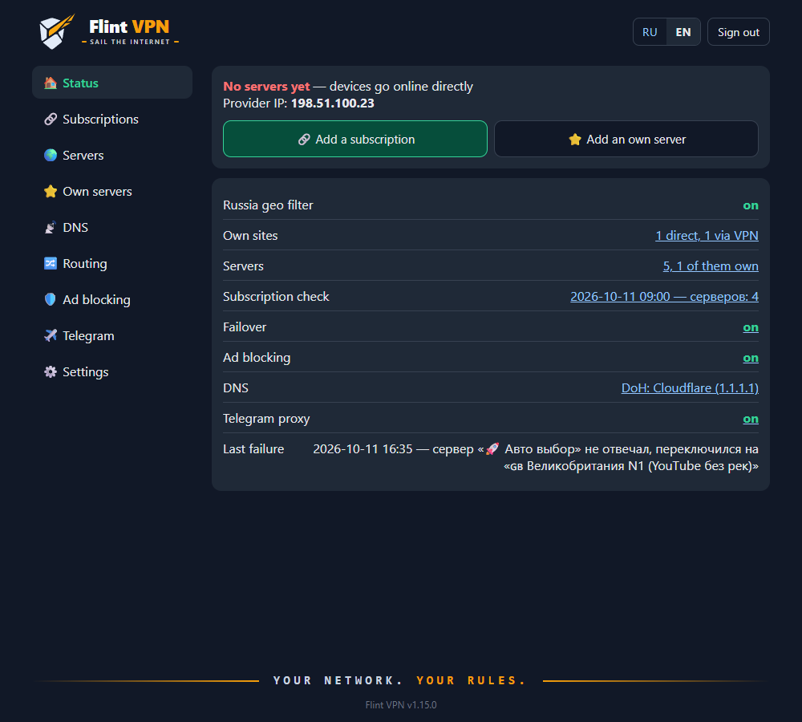

<p align="center">
  <picture>
    <source media="(prefers-color-scheme: dark)" srcset="kit/files/www/flint/logo.svg">
    
  </picture>
</p>

<h1 align="center">Flint VPN</h1>

<p align="center">
  <b>A transparent VPN (Xray, VLESS + REALITY) for a whole home network on a GL.iNet router, with a web panel.</b><br>
  <i>Your network. Your rules.</i>
</p>

<p align="center">
  <a href="README.md">Русский</a> ·
  <a href="#quick-start">Quick start</a> ·
  <a href="#documentation">Documentation</a> ·
  <a href="CHANGELOG.en.md">Changelog</a> ·
  <a href="LICENSE.en.md">License</a>
</p>

> [!IMPORTANT]
> **Free for home, study and hobby use.** Companies, government bodies and government-controlled companies need the author's written permission (which may be paid). Forking, changing and borrowing ideas is allowed, but **credit to the original is mandatory**: a whole fork, and any project that uses even a fragment of the code, must keep the `Required Notice:` lines from [LICENSE](LICENSE) and a link to this repository. The source is open, but the license is noncommercial — see [LICENSE.en.md](LICENSE.en.md) and [LICENSE](LICENSE) for details.



## About

Flint VPN turns a GL.iNet router into a transparent VPN gateway. Every device on its Wi‑Fi or LAN — phones, laptops, TVs, consoles — goes online through Xray (VLESS + REALITY) with no settings and no apps on the devices themselves. Russian sites can go directly.

> [!NOTE]
> **Tested on a GL.iNet GL-BE6500 (Flint 3e)**, GL firmware 4.x (OpenWrt 23.05), in Repeater mode (the router is connected to the main home router over Wi‑Fi).
>
> It was built for personal use, for one specific router. It should work on other OpenWrt devices (aarch64 above all), but it has not been tested there — see [Other OpenWrt routers](docs/en/install.md#other-openwrt-routers).

**Why a web panel of its own.** The ready-made solution from GitHub that I used simply refused to start on this router. So the Xray setup, server switching and everything else here is built from scratch: a set of shell scripts and a light CGI panel that runs on the stock `uhttpd` without Node.js, Python or other heavy dependencies on the router.

## Features

- **A transparent VPN for the whole network.** Client TCP traffic is redirected into Xray; there is nothing to configure on the devices.
- **Russia geo filter.** Russian sites (`geosite:category-ru`) and IPs (`geoip:ru`) go directly, the rest through the VPN. One button turns it off (everything through the VPN).
- **Your own rules.** Sites, IPs and subnets "always direct" or "always via VPN" — they outrank the geo filter.
- **Devices without VPN.** Individual clients (a TV, a console, a work laptop) always go online directly by MAC address; the rest still go through the VPN.
- **Web panel** at `http://vpn.lan:81/` with a PIN: pick a server, turn the VPN on and off, routing, own servers, subscriptions, ad blocking, the Telegram proxy, PIN change, export and import of settings. Works from a phone too. English and Russian: the language follows the browser, with a RU | EN switch in the top right corner.
- **Subscriptions from any provider.** Several subscriptions in v2rayN / Happ / Hiddify format — the servers of all of them show up in the panel, grouped by provider. The name, expiry and traffic come along by themselves. The list updates on a button or automatically (from every 30 minutes to once a day); the router downloads subscriptions directly, so a refresh works even when the current server is down.
- **Own servers.** Add by `vless://` link, by copying a subscription server or by hand; TCP (xtls-rprx-vision) or gRPC transport.
- **Failover.** Every 2 minutes the router checks the VPN; if a server stops answering while the internet works, it refreshes the subscription and moves to the first working server (or the fastest one, if you prefer).
- **Encrypted DNS** (dnscrypt-proxy) against DNS substitution by the provider; client DNS queries are forced through the router. Four modes: DoH, DNSCrypt, plain UDP and "through the tunnel" (the last one for when DNS is blocked by the resolver's name).
- **Ad blocking** for the whole network at the DNS level — the AdGuard Home that ships with GL firmware, on by one button. Lists update by themselves, individual devices and sites can be excluded, and recently blocked domains can be allowed with one button.
- **Telegram proxy** on the router ([tg-ws-proxy-rs](https://github.com/valnesfjord/tg-ws-proxy-rs)): Telegram works without the VPN — on devices without VPN, with the VPN off, and without spending subscription traffic. It is added inside Telegram with a button from the panel.
- **Access to the home network.** The main router's network, a NAS, a printer are reachable directly, without the VPN; local names (`nas01`) are set in the panel.
- **Backup and restore** with one command, and a redeploy does not lose the panel's settings. The panel settings can be downloaded as a file and uploaded to the same or another Flint right from the browser.
- **Survives a firmware upgrade** with Keep Settings checked: the VPN, the panel and all settings stay, with no redeploy needed.

## Quick start

You need a GL.iNet router (OpenWrt, aarch64) with SSH, internet access and a `vless://` subscription.

```powershell
git clone https://github.com/AndreyTokarev/Flint_Vless.git
cd Flint_Vless
Copy-Item config\flint.env.example config\flint.env   # fill in UI_PIN, SUB_URL, UPSTREAM_IF, UPSTREAM_NET
.\deploy.ps1                                          # macOS / Linux: ./deploy.sh
```

At the end of the install the panel address appears — open **http://vpn.lan:81/** and enter the PIN:

```
DNS: ok
VPN exit IP: 203.0.113.42
Panel: http://vpn.lan:81/  (PIN from flint.env)
```

Step by step, with preparing the router and every setting — [Installation](docs/en/install.md). If something went wrong — [Troubleshooting](docs/en/troubleshooting.md).

## Screenshots

| Status | Servers | Ad blocking |
|---|---|---|
|  |  |  |
| **Subscriptions** | **DNS** | **Telegram** |
|  |  |  |
| **Settings** | **Phone** | **No servers** |
|  |  |  |

The rest — login, own servers, routing, adding a server, the phone views — are in [docs/screenshots/en](docs/screenshots/en). The screenshots use demo data: documentation IP ranges, made-up servers and keys. They are refreshed with one command — `tests/demo.sh` on the router saves every page in both languages, and `tools/screenshot.js` captures them through a headless browser.

## Documentation

| Page | What it covers |
|---|---|
| [Installation](docs/en/install.md) | requirements, preparing the router, every `flint.env` setting, what the installer does, other routers |
| [Web panel](docs/en/panel.md) | the panel tabs, common tasks, devices on the network, access from the main router's network |
| [Servers and subscriptions](docs/en/servers.md) | servers by hand, subscriptions, failover, TLS fingerprint and mux |
| [DNS and ad blocking](docs/en/dns-adblock.md) | DNS modes, local names, filter lists and rules, where ads remain |
| [Telegram proxy](docs/en/telegram-proxy.md) | why it is needed, how to turn it on, how it works, every switch |
| [Maintenance](docs/en/maintenance.md) | backup and restore, firmware upgrade, uninstall, router commands |
| [Troubleshooting](docs/en/troubleshooting.md) | symptom table, server switches and TIME_WAIT, a forgotten PIN, limitations |
| [How it works](docs/en/internals.md) | the traffic diagram, project layout, services, security, contributing |

Everything that changed per version is in [CHANGELOG.en.md](CHANGELOG.en.md). To check the project on a computer (no router needed): `.\tools\check.ps1`.

## How it works

```
 Phone / laptop / TV
          │  Wi-Fi or LAN, nothing to configure
          ▼
 ┌──────────────── Flint (OpenWrt) ────────────────┐
 │ DNS: [AdGuard Home] ──► dnsmasq ──► DoH         │
 │ iptables: TCP from br-lan ──► Xray :12345       │
 │           (devices without VPN — directly)      │
 │ Xray: Russia and own "direct" ──► direct        │
 │       everything else ──► VLESS + REALITY       │
 │ uhttpd :81 ──► web panel (CGI)                  │
 └─────────────────────────────────────────────────┘
          │
          ▼
 Main router ──► internet
```

More — in [How it works](docs/en/internals.md).

## License

Free for personal and noncommercial use, with mandatory credit to the original project. Commercial use and use by government bodies and government-controlled companies require the author's permission. License text: [LICENSE](LICENSE) (Flint VPN Noncommercial License 1.0, based on PolyForm Noncommercial 1.0.0); summary and contribution terms: [LICENSE.en.md](LICENSE.en.md).

The source is open, but the license is noncommercial: this is not an OSI license, but source-available software. Your own changes, forks and reuse of the code are allowed, but the project name, the `Required Notice:` lines and the link to the original must be kept — including when only a part of the code is reused in another project. Permission for commercial or government use is granted in writing: open an [issue](https://github.com/AndreyTokarev/Flint_Vless/issues).

## Credits

- [Xray-core](https://github.com/XTLS/Xray-core) — VLESS, REALITY and routing;
- [Loyalsoldier/v2ray-rules-dat](https://github.com/Loyalsoldier/v2ray-rules-dat) — the geoip and geosite databases;
- [dnscrypt-proxy](https://github.com/DNSCrypt/dnscrypt-proxy) — DNS over DoH and DNSCrypt;
- [AdGuard Home](https://github.com/AdguardTeam/AdGuardHome) and [AdGuard filters](https://github.com/AdguardTeam/AdGuardSDNSFilter) — ad blocking;
- [tg-ws-proxy-rs](https://github.com/valnesfjord/tg-ws-proxy-rs) and [Flowseal/tg-ws-proxy](https://github.com/Flowseal/tg-ws-proxy) — the Telegram proxy;
- [OpenWrt](https://openwrt.org) and [GL.iNet](https://www.gl-inet.com).

This project is not affiliated with GL.iNet or any VPN provider. Use it in accordance with the laws of your country.
