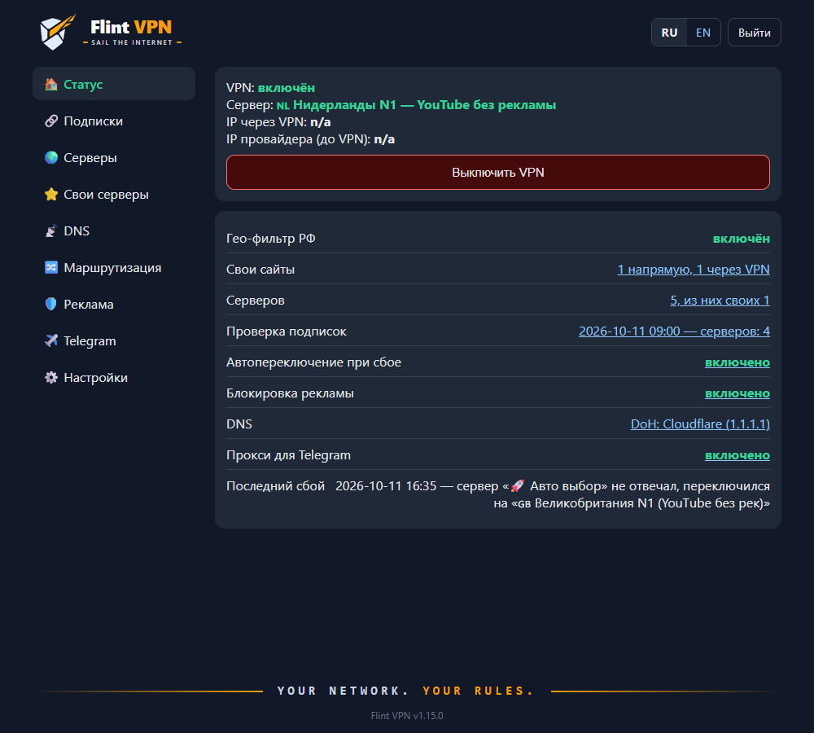
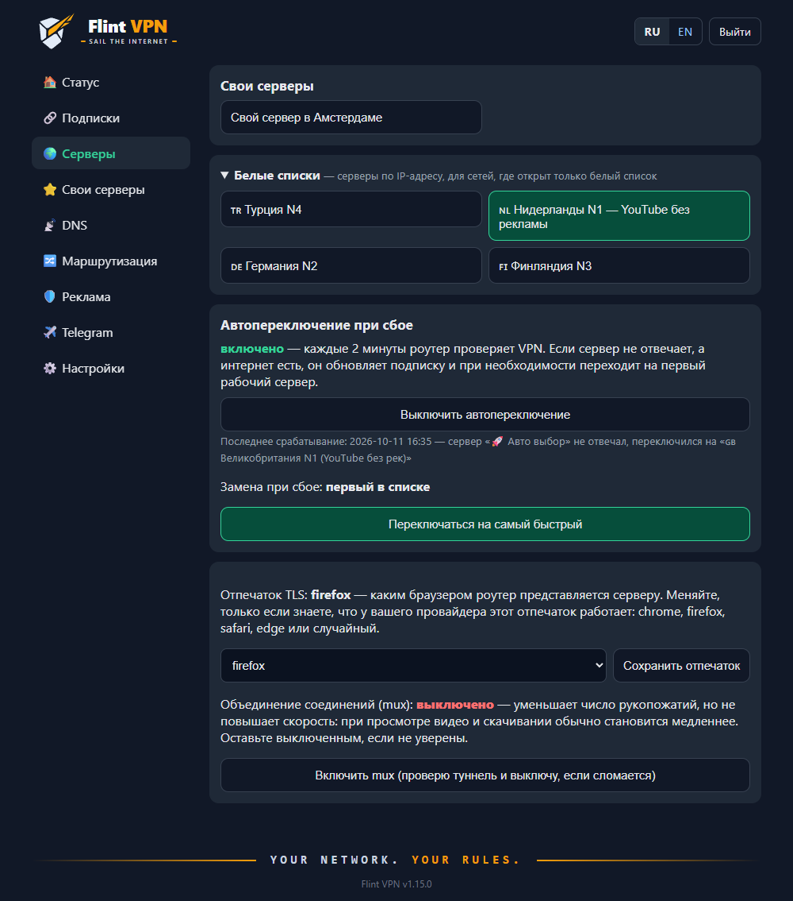
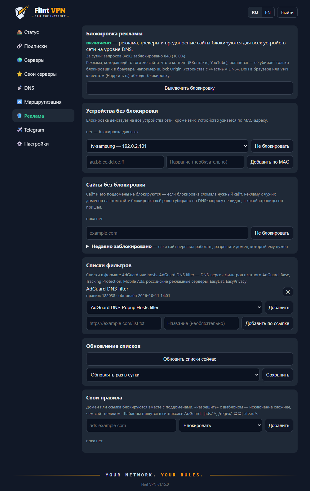
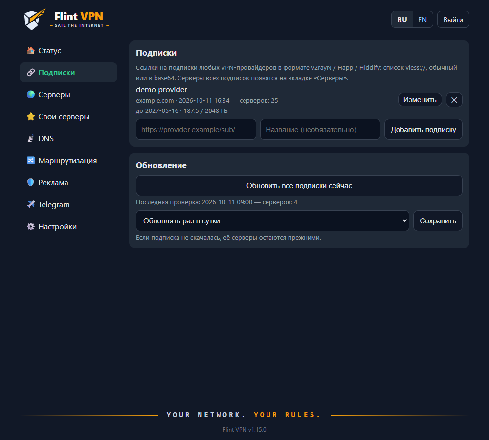
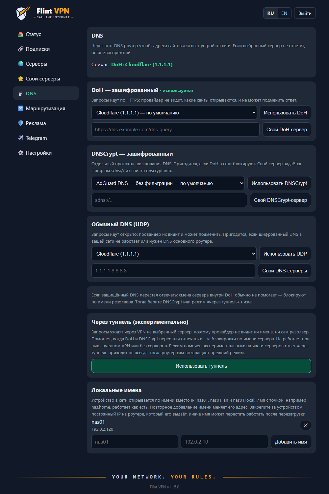
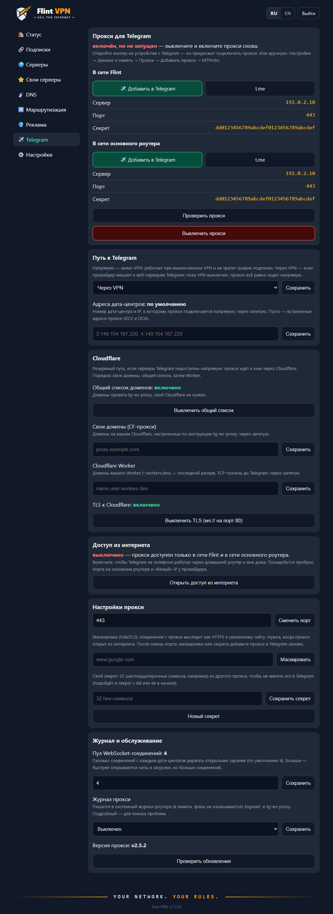
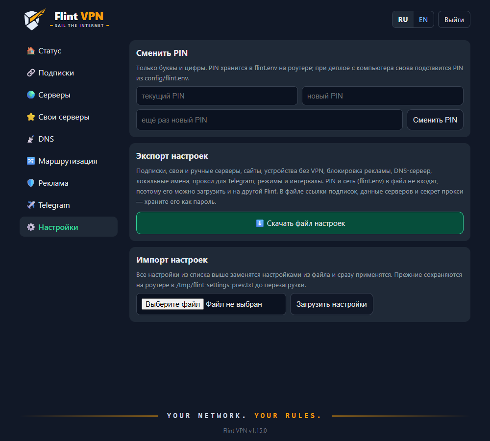
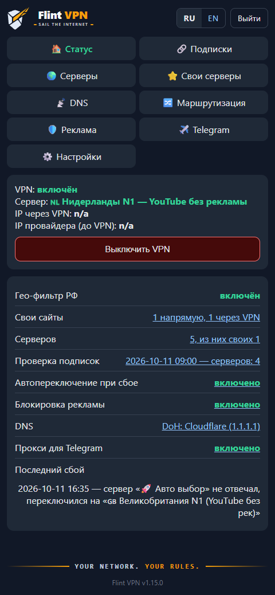
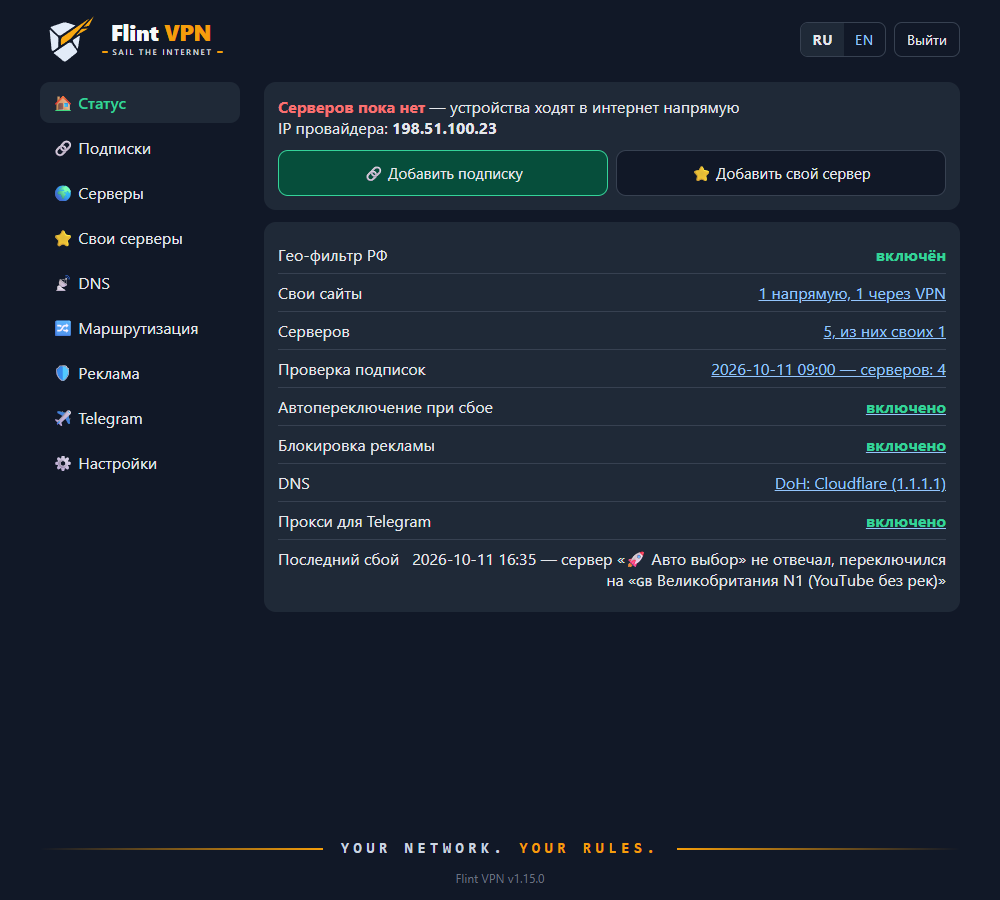

<p align="center">
  <picture>
    <source media="(prefers-color-scheme: dark)" srcset="kit/files/www/flint/logo.svg">
    
  </picture>
</p>

<h1 align="center">Flint VPN</h1>

<p align="center">
  <b>Прозрачный VPN (Xray, VLESS + REALITY) для всей домашней сети на роутере GL.iNet с веб-панелью управления.</b><br>
  <i>Your network. Your rules.</i>
</p>

<p align="center">
  <a href="README.en.md">English</a> ·
  <a href="#быстрый-старт">Быстрый старт</a> ·
  <a href="#документация">Документация</a> ·
  <a href="CHANGELOG.md">Изменения</a> ·
  <a href="LICENSE.ru.md">Лицензия</a>
</p>

> [!IMPORTANT]
> **Бесплатно для дома, учёбы и хобби.** Компаниям, а также государственным органам и компаниям — только с письменного разрешения автора (может быть платным). Форкать, менять и брать идеи можно, но **отсылку к оригиналу сохранять обязательно**: и целый форк, и проект, где использован любой фрагмент кода, должны нести строки `Required Notice:` из [LICENSE](LICENSE) и ссылку на этот репозиторий. Исходный код открыт, но лицензия некоммерческая — подробно в [LICENSE.ru.md](LICENSE.ru.md) и [LICENSE](LICENSE).



## О проекте

Flint VPN превращает роутер GL.iNet в прозрачный VPN-шлюз. Все устройства, подключённые к его Wi‑Fi или LAN, — телефоны, ноутбуки, телевизоры, приставки — ходят в интернет через Xray (VLESS + REALITY) без каких-либо настроек и приложений на самих устройствах. Российские сайты при этом могут идти напрямую.

> [!NOTE]
> **Проверено на GL.iNet GL-BE6500 (Flint 3e)**, прошивка GL 4.x (OpenWrt 23.05), режим Repeater (роутер подключён к Wi‑Fi основного домашнего роутера).
>
> Сборка делалась для личного использования, под свой роутер. По идее она должна работать и на других устройствах с OpenWrt (прежде всего aarch64), но там она не проверялась — см. [Другие роутеры на OpenWrt](docs/install.md#другие-роутеры-на-openwrt).

**Почему появилась своя веб-панель.** Готовое решение с GitHub, которым я пользовался, на этом роутере просто отказалось запускаться. Поэтому настройка Xray, переключение серверов и всё остальное здесь сделаны своими силами: набор shell-скриптов и лёгкая CGI-панель, которая работает на штатном `uhttpd` без Node.js, Python и прочих тяжёлых зависимостей на роутере.

## Возможности

- **Прозрачный VPN для всей сети.** TCP-трафик клиентов перенаправляется в Xray; на устройствах ничего настраивать не нужно.
- **Гео-фильтр РФ.** Российские сайты (`geosite:category-ru`) и IP (`geoip:ru`) идут напрямую, остальное — через VPN. Выключается одной кнопкой (всё через VPN).
- **Свои правила.** Сайты, IP и подсети «всегда напрямую» или «всегда через VPN» — важнее гео-фильтра.
- **Устройства без VPN.** Отдельные клиенты (телевизор, консоль, рабочий ноутбук) всегда ходят в интернет напрямую по MAC-адресу; остальные по-прежнему через VPN.
- **Веб-панель** `http://vpn.lan:81/` по PIN: выбор сервера, включение и выключение VPN, маршрутизация, свои серверы, подписки, блокировка рекламы, прокси для Telegram, смена PIN, экспорт и импорт настроек. Работает и с телефона. Русский и английский интерфейс: язык выбирается по браузеру, переключатель RU | EN в правом верхнем углу.
- **Подписки любых провайдеров.** Можно подключить несколько подписок в формате v2rayN / Happ / Hiddify — серверы всех появятся в панели, сгруппированные по провайдеру. Название, срок действия и трафик подписки подтягиваются сами. Список обновляется кнопкой или автоматически (от каждых 30 минут до раза в сутки); подписки роутер скачивает напрямую, так что обновление работает, даже когда текущий сервер лёг.
- **Свои серверы.** Добавление по ссылке `vless://`, копией сервера из подписки или вручную; транспорт TCP (xtls-rprx-vision) или gRPC.
- **Автопереключение при сбое.** Каждые 2 минуты роутер проверяет VPN; если сервер перестал отвечать, а интернет есть, обновляет подписку и переходит на первый рабочий сервер (или на самый быстрый — по желанию).
- **Зашифрованный DNS** (dnscrypt-proxy) — против подмены DNS провайдером; DNS-запросы клиентов принудительно идут через роутер. Четыре режима: DoH, DNSCrypt, обычный UDP и «через туннель» (последний — когда блокируют DNS по имени резолвера).
- **Блокировка рекламы** для всей сети на уровне DNS — AdGuard Home из прошивки GL, включается кнопкой. Списки обновляются сами, отдельные устройства и сайты можно исключить, а недавно заблокированные домены разрешить одной кнопкой.
- **Прокси для Telegram** на роутере ([tg-ws-proxy-rs](https://github.com/valnesfjord/tg-ws-proxy-rs)): Telegram работает без VPN — на устройствах без VPN, при выключенном VPN и не тратя трафик подписки. Подключается в самом Telegram кнопкой из панели.
- **Доступ к домашней сети.** Сеть основного роутера, NAS, принтер доступны напрямую, без VPN; локальные имена (`nas01`) задаются в панели.
- **Бэкап и восстановление** одной командой, повторный деплой не теряет настройки из панели. Настройки панели можно скачать файлом и загрузить на этот же или другой Flint прямо из браузера.
- **Переживает обновление прошивки** с галочкой «Сохранить настройки»: VPN, панель и все настройки остаются, деплой заново не нужен.

## Быстрый старт

Нужен роутер GL.iNet (OpenWrt, aarch64) с SSH, интернетом и подпиской `vless://`.

```powershell
git clone https://github.com/AndreyTokarev/Flint_Vless.git
cd Flint_Vless
Copy-Item config\flint.env.example config\flint.env   # впишите UI_PIN, SUB_URL, UPSTREAM_IF, UPSTREAM_NET
.\deploy.ps1                                          # macOS / Linux: ./deploy.sh
```

В конце установки появится адрес панели — откройте **http://vpn.lan:81/** и введите PIN:

```
DNS: ok
VPN exit IP: 203.0.113.42
Panel: http://vpn.lan:81/  (PIN from flint.env)
```

Подробно, по шагам, с подготовкой роутера и всеми параметрами — [Установка](docs/install.md). Если что-то не получилось — [Решение проблем](docs/troubleshooting.md).

## Скриншоты

| Статус | Серверы | Реклама |
|---|---|---|
|  |  |  |
| **Подписки** | **DNS** | **Telegram** |
|  |  |  |
| **Настройки** | **Телефон** | **Без серверов** |
|  |  |  |

Остальные экраны — вход, свои серверы, маршрутизация, добавление сервера, мобильные виды — в папке [docs/screenshots](docs/screenshots). На скриншотах демо-данные: адреса из документационных диапазонов, выдуманные серверы и ключи. Обновляются они одной командой — `tests/demo.sh` на роутере сохраняет все страницы в двух языках, а `tools/screenshot.js` снимает их через headless-браузер.

## Документация

| Раздел | О чём |
|---|---|
| [Установка](docs/install.md) | требования, подготовка роутера, все параметры `flint.env`, что делает установщик, другие роутеры |
| [Веб-панель](docs/panel.md) | вкладки панели, частые задачи, устройства в сети, доступ из сети основного роутера |
| [Серверы и подписки](docs/servers.md) | серверы вручную, подписки, автопереключение, отпечаток TLS и mux |
| [DNS и блокировка рекламы](docs/dns-adblock.md) | режимы DNS, локальные имена, списки и правила блокировки, где реклама останется |
| [Прокси для Telegram](docs/telegram-proxy.md) | зачем нужен, как включить, как устроен, все переключатели |
| [Обслуживание](docs/maintenance.md) | бэкап и восстановление, обновление прошивки, удаление, команды на роутере |
| [Решение проблем](docs/troubleshooting.md) | таблица симптомов, смена сервера и TIME_WAIT, забыли PIN, ограничения |
| [Как это устроено](docs/internals.md) | схема трафика, структура проекта, службы, безопасность, участие в разработке |

Всё, что менялось по версиям, — в [CHANGELOG.md](CHANGELOG.md). Проверка проекта на компьютере (без роутера): `.\tools\check.ps1`.

## Как это работает

```
 Телефон / ноутбук / ТВ
          │  Wi-Fi или LAN, без настроек
          ▼
 ┌──────────────── Flint (OpenWrt) ────────────────┐
 │ DNS: [AdGuard Home] ──► dnsmasq ──► DoH         │
 │ iptables: TCP из br-lan ──► Xray :12345         │
 │           (устройства без VPN — напрямую)       │
 │ Xray: РФ и свои «напрямую» ──► direct           │
 │       остальное ──► VLESS + REALITY             │
 │ uhttpd :81 ──► веб-панель (CGI)                 │
 └─────────────────────────────────────────────────┘
          │
          ▼
 Основной роутер ──► интернет
```

Подробнее — [Как это устроено](docs/internals.md).

## Лицензия

Бесплатно для личного и некоммерческого использования, с обязательным указанием исходного проекта. Коммерческое использование, а также использование государственными органами и компаниями — только по разрешению автора. Текст лицензии — [LICENSE](LICENSE) (Flint VPN Noncommercial License 1.0, на основе PolyForm Noncommercial 1.0.0), пояснение и условия для pull request'ов — [LICENSE.ru.md](LICENSE.ru.md) (по-русски) и [LICENSE.en.md](LICENSE.en.md) (in English).

Исходный код открыт, но лицензия некоммерческая: это не OSI-лицензия, а «исходники открыты с условиями» (source-available). Свои изменения, форки и заимствование кода разрешены, но имя проекта, строки `Required Notice:` и ссылку на оригинал нужно сохранять — в том числе когда в свой проект берут не весь код, а его часть. Разрешение на коммерческое или государственное использование выдаётся письменно: напишите в [Issues](https://github.com/AndreyTokarev/Flint_Vless/issues).

## Благодарности

- [Xray-core](https://github.com/XTLS/Xray-core) — VLESS, REALITY и маршрутизация;
- [Loyalsoldier/v2ray-rules-dat](https://github.com/Loyalsoldier/v2ray-rules-dat) — базы geoip и geosite;
- [dnscrypt-proxy](https://github.com/DNSCrypt/dnscrypt-proxy) — DNS через DoH и DNSCrypt;
- [AdGuard Home](https://github.com/AdguardTeam/AdGuardHome) и [фильтры AdGuard](https://github.com/AdguardTeam/AdGuardSDNSFilter) — блокировка рекламы;
- [tg-ws-proxy-rs](https://github.com/valnesfjord/tg-ws-proxy-rs) и [Flowseal/tg-ws-proxy](https://github.com/Flowseal/tg-ws-proxy) — прокси для Telegram;
- [OpenWrt](https://openwrt.org) и [GL.iNet](https://www.gl-inet.com).
